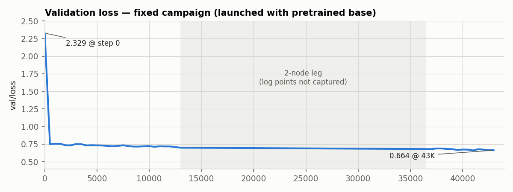
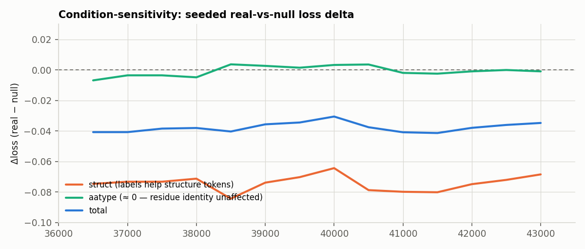
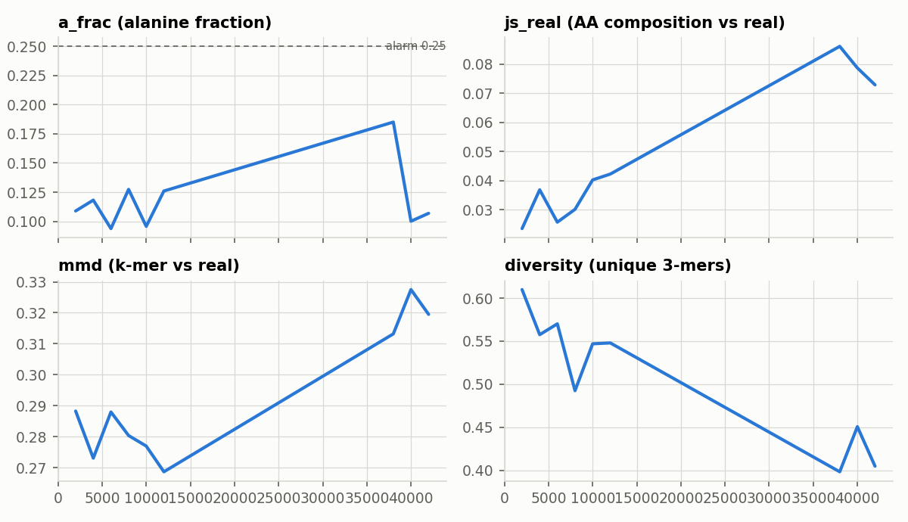
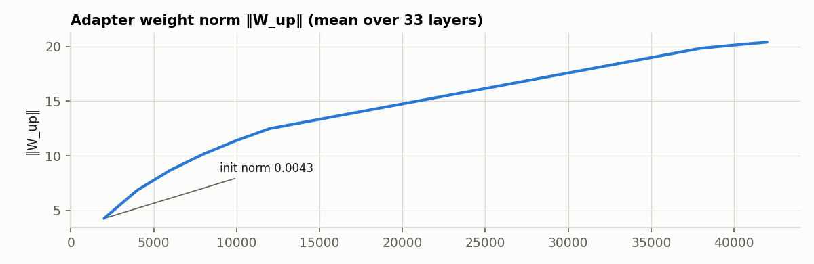

# Weekly meeting 2026-10-27 — debugging → validated pipeline → running campaign

*Presenter notes for the weekly meeting. Comparison frame: the 2026-10-20 meeting
(PI feedback: debug the collapse, validate the pipeline, instrumented retrain).
Figures are in `reports/figures/`; live data source: the 8-node Karolina run
(job 5272588 lineage), console probe telemetry at 500-step cadence.*

---

## TL;DR vs last week

Last week ended with: root cause identified (the "collapse" was a
randomly-initialized encoder — the pretrained weights were never loaded), a
corrected configuration, and a *plan* gated on validating the pipeline. This
week: **the pipeline is validated (23 automated checks + every smoke layer),
the corrected campaign is running at scale (8 nodes, 64 GPUs, step 43K+, on
schedule to finish 100K inside the allocation), and the instrumented probe is
producing the first real condition-sensitivity and drift measurements of the
method.** Two eval-stack regressions were caught and fixed before they could
contaminate results. One monitoring sensor had a bug (fixed; see below).

---

## 1. Pipeline validation (Phase 0 — complete)

- **23-check gauntlet** (`scripts/debug/phase0_gauntlet.py`): pretrained-base
  bitwise identity, identity-at-init across forward/generation/infill,
  replicated-forward equivalence, adapter invocation census, null-path +
  eval-mode consistency, CFG degeneracy, gradient flow (802/802 conditioning
  params), training-data round-trip, label-join provenance. All green.
- **Found and fixed live during validation**: `eval/go.obo` had vanished from
  the local machine and the scorer *silently skipped* GO-DAG expansion — the
  exact failure mode the September log warned about. The scorer now fails
  loudly; the regression re-run caught it before it could touch any new
  results (MRR/MMD/IPR reproduced bit-exact; GO drift traced to an ontology
  release difference, documented).

## 2. Launch campaign (six smoke rounds, each one real bug)

| Round | Symptom | Root cause | Fix |
|---|---|---|---|
| 1 | srun: memory trio mutually exclusive | submission-env leak via `--export=ALL` | unset in-script |
| 2 | exit 127 | `exec` on a bash *function* | plain call |
| 3 | 16 rogue 2-process worlds | `--cleanenv` stripped DDP env | torch env forwarding |
| 4 | Lightning SLURM validation refusals | SLURMEnvironment vs per-task pattern | **architecture switch: torchrun**, 1 task/node, 8 workers |
| 5 | `NVML: Not Found` in NCCL topology | cgroup hid 7/8 GPUs per task | full-GPU cgroup per node (torchrun) |
| 6 | `KeyError('LOCAL_RANK')`, entrypoint, `MAX_STEPS` unbound, resume key | ordering + PL 2.2 API drift | all fixed |

Validated end-to-end: fresh start, 16→64-rank worlds, checkpointing
(`save_top_k: -1` — the every-2,000-step series is preserved this time),
resume, and the **Tier-1 conditioning probe** (PI feedback item 3, delivered):
per-500-step validation, per-2,000-step generation probe with
condition-sensitivity decomposition, drift monitors, pre-registered alarm.

## 3. The fixed campaign — live readings at step 43K

**Health:** val/loss 2.329 → **0.664** (true-pretrained base; the broken
campaign plateaued at ~1.95). 8 nodes / 64 GPUs at **1.26 it/s** — 1.94× the
2-node rate, on schedule to finish 100K ~mid-day Oct 27 inside the allocation.

**Condition-sensitivity (the fixed sensor's first real data):**

- **struct Δ ≈ −0.07, consistently negative**: the GO/IPR labels measurably
  help structure-token prediction.
- **aatype Δ ≈ 0 (±0.003)**: labels do *not* yet help residue-identity
  prediction.
- Interpretation: this is the **granularity asymmetry predicted by the
  architecture analysis, observed live** — global protein-level labels carry
  fold/domain-class information (structure tokens) but no positional leverage
  for residue identity. This meets the pre-registered trigger for the
  capacity/position-aware-conditioning ablation conversation (Q8), to be
  decided with the eval-series numbers after the campaign.

**Generation-side drift (the monitored risk, elevated but sub-alarm):**

- `a_frac` spiked to 0.185 @38K (alarm = 0.25 on two consecutive probes — not
  tripped), receded to ~0.10; `js_real` ~4× early-training; `mmd` +0.05;
  **diversity −33%**.
- Reading: the same realism-vs-training tradeoff as the original campaign
  (E4), but ~4× milder in absolute terms — a real property of adapter
  training, no longer confounded by the broken base.
- Consequence for checkpoint selection: **val/loss and generation quality are
  decoupling** (val/loss best-ever while drift grows). The every-2,000-step
  series preserves the full tradeoff; the eval sweep across ~10–20K-spaced
  checkpoints will locate where generation quality peaked — that ckpt, not
  necessarily `best.ckpt`, is the right one for the generation numbers.

## 4. Constraint and plan

The project allocation expires **Oct 27 ~24:00** → the campaign lands at
~step 85–95K rather than 100K (node-hours are not binding; validity is). The
2-node leg ran overnight; the run switches to 8 nodes this morning
(`scancel --signal=KILL` + resubmit — the chaining trap requires KILL, now
documented in the runbook). Eval stack and analysis move to the local
workstation with checkpoints synced from Karolina (Q3).

## 5. Queue (debug plan "Post-launch queue", Q1–Q10)

| | Item | Status |
|---|---|---|
| Q1 | Monitor 100K trajectory | in flight (this data) |
| Q2 | Scorer regression | **done** — caught the go.obo silent-skip |
| Q3 | Checkpoint sync → local | pending (run end) |
| Q4 | Eval-stack validation | generation stage done locally; IPS/DeepGO assets restoring |
| Q5 | Per-layer learning figures for the paper | script pending; probe data already collected |
| Q6 | Predictor eval on periodic ckpts | ready (eval_pipeline, CKPT=auto) |
| Q7 | Phase 2: steering cells + anticipation table | gated on eval numbers |
| Q8 | Ablations (adapter-input, capacity, position-aware) | **triggered by the aatype-Δ≈0 finding**; needs compute decision |
| Q10 | Offline condition-sensitivity | **done** at 18K: conditions strongly represented (cos 0.144) and logit-active (mean \|Δ\| 0.25) |

## 6. Asks / decisions for the PIs

1. **Allocation renewal timing** — the ablation arms (Q8) need compute after
   Oct 27; the aatype-Δ≈0 finding makes them evidence-triggered now.
2. **Eval placement** — full eval sweep locally on synced ckpts (recommended;
   stack validated today) vs a residual cluster window.
3. **Ablation priority** given the live finding: position-aware conditioning
   (the aatype gap is a *placement* gap, not only a capacity gap) vs capacity
   scaling vs adapter-input variants.
