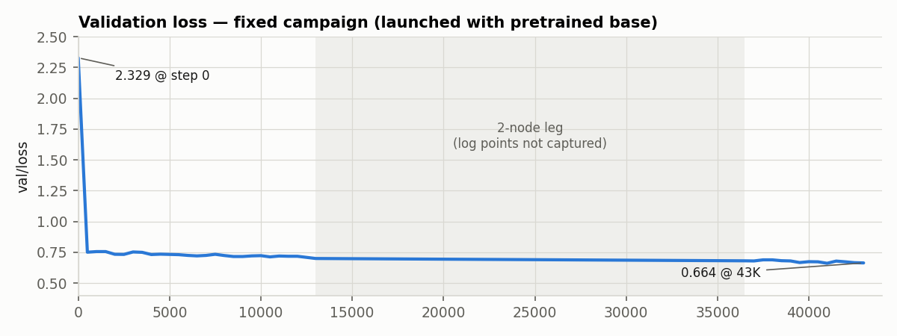
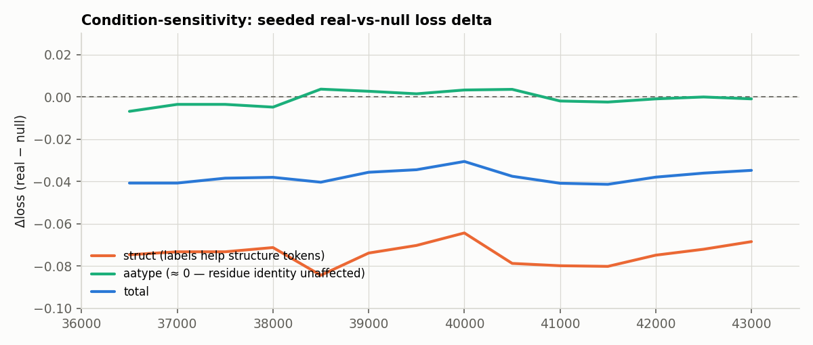
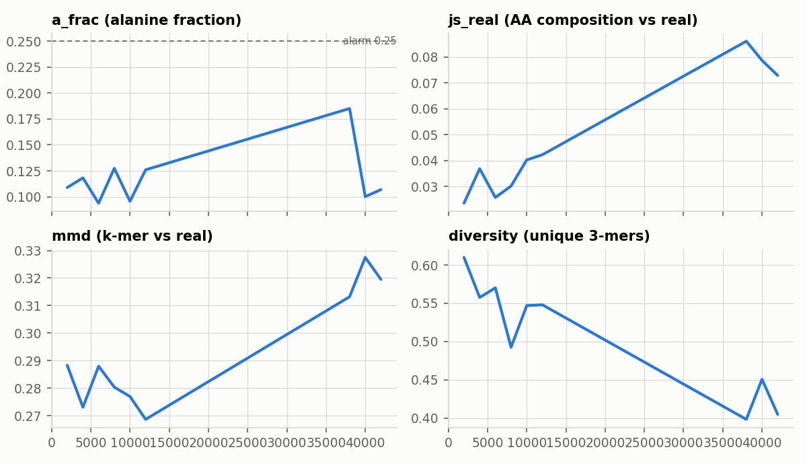
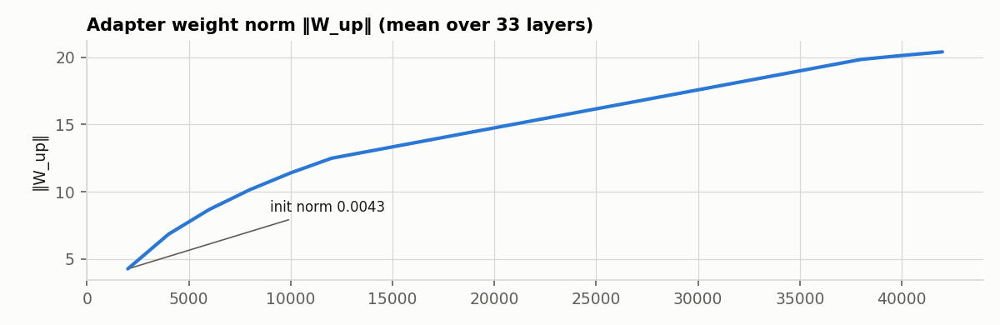

# Weekly meeting 2026-11-10 — three weeks in one: validation, launch, 42K steps banked, host switch

*Presenter notes. Comparison frame: the 2026-10-20 meeting (PI feedback:
debug the collapse, validate the pipeline, instrumented retrain). Since then
no live meeting — this report covers the three-week gap in one arc:
**root cause → validated pipeline → launch → 42K steps banked → host switch
to Meluxina.** Figures from the campaign's own telemetry
(`reports/figures/wk27_*.png`).*

---

## TL;DR vs three weeks ago

| | Oct 20 | Today |
|---|---|---|
| Root cause of the "collapse" | unknown (model vs bug) | **known**: a config bug left the pretrained weights unloaded — the "collapse" was a random-init encoder, not the method |
| Pipeline trust | assumed, unvalidated | **23-check gauntlet, all green** + two eval-stack regressions caught and fixed |
| Corrected training | not started | **42K steps banked, checkpointed every 2,000**, on the true pretrained base, with live condition-sensitivity telemetry |
| Hosting | Karolina (allocation burned by 12 wasted FRESH-loop cycles) | **Meluxina p201437**, runbook updated, setup scripted, resume-from-42K ready |

---

## 1. The root cause, and what it means (recap, 2 min)

The original "mode collapse" was **not the method**: a one-line config flag
(`pretrain: false`) silently skipped loading DPLM-2's pretrained weights, so
the adapters trained on a **randomly-initialized frozen encoder**. Fingerprints:
step-0 val/loss 2.99 (vs 2.33 with the true base), all-zero `lm_head.bias`,
bit-exact reconstruction with a seeded random init. Consequences for
interpretation: every pre-fix result described a random encoder + adapters —
the method itself was never tested. The fix is locked behind a 23-check
validation gauntlet; the pre-fix checkpoints are archived, not deleted.

## 2. Pipeline validation — everything the PIs asked to trust is now checked

23 automated checks (`scripts/debug/phase0_gauntlet.py`), all green:
pretrained-base bitwise identity, identity-at-init across
forward/generation/infill, replicated-forward equivalence, adapter census,
null-path + eval-mode consistency, CFG degeneracy, gradient flow
(802/802 conditioning params), training-data round-trip, label-join
provenance. Plus: the eval stack regression re-run **caught a real failure
before it mattered** — `go.obo` had vanished locally and the scorer silently
skipped GO-DAG expansion (now fails loudly). And the launch campaign itself
(six smoke rounds, six real bugs — one per round) produced the **torchrun
architecture** that finally formed a true 16-rank world on Karolina.

## 3. The corrected campaign — 42K steps banked on Karolina

- 8 nodes × 8 GPUs, **1.26 it/s** (1.94× the 2-node rate), rank-sharded data
  (effective batch 16K), checkpoints every 2,000 steps — the series is
  preserved, which matters because of §5.
- Reached **step 42K** before the allocation expired; the NCCL transport
  (Socket fallback — `libibverbs` missing in the sandbox) flaked and ended
  the run; ≤2,000 steps lost, every checkpoint intact.
- **Live telemetry** (the Tier-1 probe, PI feedback item 3 — delivered):

**Condition-sensitivity decomposition** (`probe/loss_delta`, seeded
real-vs-null so only the condition varies):

- **struct Δ ≈ −0.07, consistently negative** — the GO/IPR labels measurably
  help structure-token prediction.
- **aatype Δ ≈ 0 ± 0.003** — labels do *not* yet help residue-identity
  prediction.
- This is the **granularity asymmetry (global labels → structure-class info,
  not positional residue info) observed live** — the pre-registered trigger
  for the position-aware-conditioning / capacity ablation conversation (Q8).

**Generation drift** (composition/realism of from-scratch probe generations):

- `a_frac` peaked 0.185 @38K (alarm threshold 0.25 on two consecutive probes
  — not tripped), receded to ~0.10; `js_real` rose ~4× over early training;
  **diversity −33 %**; `mmd` +0.05.
- Reading: the realism-vs-training tradeoff (E4) is **real and now measured
  on a correctly-trained base** — ~4× milder than the broken campaign's
  numbers, and the every-2,000-step series localizes where generation quality
  peaks. **Checkpoint selection implication: the best-val ckpt is not
  automatically the best generation ckpt** — the eval sweep across the series
  will locate the peak.

Adapter norms grew 0.0043 → 20.4 (init 1e-5 std); per-layer updates reach
16 % of the residual-stream norm — the adapters are a substantial second
model now, which is exactly why the struct-vs-aatype decomposition above is
the diagnostic that matters.

## 4. One monitoring bug, found and fixed mid-run

The `loss_delta` sensor read exactly 0 for the first 14K steps — a callback
bug forced *both* passes through the null condition, making the sensor blind
by construction. Caught because the flat line contradicted 3,000× adapter
growth; fixed (`d2537f1`); the offline `cond_sensitivity.py` measurement
covered the gap and confirmed at 18K that the condition pathway is plumbed
and active (logit |Δ| ≈ 0.25, condition-space spread healthy). The fixed
sensor's first live readings are the §3 decomposition above.

## 5. Switching to Meluxina (p201437)

- Runbook updated with a returning-with-a-new-project section:
  account sed (p201418 → **p201437**), transfer list, IPS-from-EBI install,
  resume-from-42K guidance.
- The docker image was restructured to be **self-contained for eval**:
  `obonet`, `go.obo`, and the CFP-Gen eval split are now baked in (new tag
  `…-cond-eval` to be built+pushed); the internet-downloadable assets
  (ESM-2 3B ckpts from fair-esm, DeepGO data from bio2vec, IPS from EBI)
  ride a one-command bootstrap script per host
  (`scripts/eval/download_eval_assets.sh`) — the correct implementation of
  "downloads at the bottom" (Docker layers are static after push; a bootstrap
  script is what actually runs on a new host).
- Meluxina upside: its 4-GPU DDP transport ran the original 100K-step
  campaign without a single NCCL flake — the Socket fragility that ended the
  Karolina leg at 42K is a Karolina-container issue.

## 6. Immediate next steps

1. **Eval on the 42K ckpt** (local 3090, ~2–3 h, commands ready): the first
   valid function-recovery + generation-realism numbers of the project.
   *[presenter: insert numbers if the run has completed]*
2. **Meluxina training resume from step_41999** (≈ 25 h on 1×4-GPU node →
   100K) — after the smoke test on the new project.
3. **Eval sweep across the ckpt series** (12K → 42K) → the
   generation-quality-vs-training curve → checkpoint selection for the paper.
4. **Q8 ablation decision** with those numbers: position-aware conditioning
   vs capacity vs adapter-input variants — the aatype-Δ≈0 finding makes
   position-awareness the leading candidate.

## 7. Asks

- **Meluxina node count for the resume**: 1×4-GPU (≈ 25 h) vs 2×4-GPU
  (≈ 13 h, if the project's allocation covers it).
- Preference on the ablation arms to prioritize (Q8) once the eval series is
  in.
